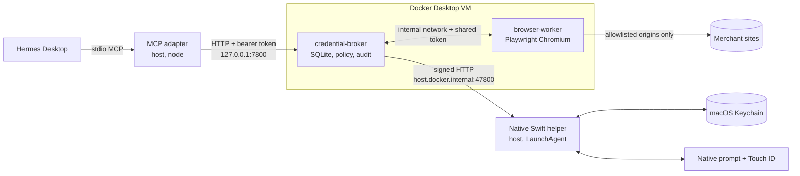

# AgentVault

Self-hosted credential broker and controlled browser for the Hermes AI agent. Hermes asks to sign in to a site; you approve in a native macOS prompt (with Touch ID), or per grant in Telegram, Discord or automatically; a sandboxed browser types the password so the agent never sees it. Purchases are blocked at the network layer until you approve the exact order.

**Status: MVP.** The Swift helper in `native/AgentVaultHelper/` has been built on macOS, paired with the broker and used for a fake-account login (Keychain storage, approval prompt and loopback server). Its protocol crypto (`Crypto.swift`) is also verified against the broker by `scripts/verify-crypto-interop.sh`. Denial, purchase approval, Touch ID and replay rejection have not been exercised by hand yet. Everything else (broker, browser worker, MCP adapter, dev helper) is covered by tests against a Node dev helper that implements the same protocol. See [docs/security-limitations.md](docs/security-limitations.md).

## Architecture



- The agent only ever talks to the broker through the MCP adapter. The broker never returns credentials or cookies.
- Passwords live in the macOS Keychain, owned by the helper. They leave it only after you approve, sealed to the broker's key, and go straight into the browser worker's login form.
- Details: [docs/architecture.md](docs/architecture.md), [docs/threat-model.md](docs/threat-model.md).

## Layout

```
src/broker/         policy core, agent API (:7800), worker-facing API (:7801), SQLite, admin commands
src/browser-worker/ Playwright sessions, network guard, snapshot, scrubbing
src/mcp-adapter/    stdio MCP server for Hermes
src/dev-helper/     Node stand-in for the native helper (Linux dev and CI only)
src/cli/            host-side `agentvault` CLI
src/shared/         tool schemas, site schema, helper/worker protocols, crypto
native/AgentVaultHelper/  Swift helper (SwiftPM): pair | enroll | delete | serve   (not yet built on macOS)
sites/              reviewed site adapters (JSON)
migrations/         SQLite schema
mock-shop/          local shop used by tests
docker/ docker-compose.yml   broker and worker images, stack definition
scripts/            install.sh, start.sh, stop.sh, launchd/dev.agentvault.helper.plist
hermes/             config.example.yaml, SKILL.md (installed to ~/.hermes/skills/agentvault)
test/               unit, e2e (real Chromium), docker smoke
skills/setup/       agent-guided install skill
docs/               architecture, ADRs, research, threat model, limitations, operations
```

## Quick start (macOS)

Prerequisites: Docker Desktop, Node 24, Xcode Command Line Tools (Swift 5.9+), Hermes Desktop.

To have an agent walk you through it, point it at [skills/setup/SKILL.md](skills/setup/SKILL.md).

```bash
scripts/install.sh                           # builds the helper, starts the stack, pairs keys, creates the agent token
agentvault credential add lululemon --site <site>   # password is typed into the native helper UI
agentvault grant lululemon                   # add --transactions to allow purchase approval requests
```

`<site>` is the `id` of a file in `sites/`. Only `test-shop` ships; add real sites per [docs/operations.md](docs/operations.md#adding-a-site-adapter). The installer registers the MCP server with `hermes mcp add` (or prints the config below if the `hermes` CLI is missing) and installs the Hermes skill.

## Quick start (Linux dev)

No Keychain, no native prompts. The dev helper stores credentials in plaintext JSON and asks for approval on a TTY. Fake credentials only.

```bash
pnpm install
npx playwright install chromium
pnpm test                                     # unit + e2e
mkdir -p secrets && openssl rand -hex 32 > secrets/worker_token   # skip if the file exists
docker compose --profile dev up -d            # broker, worker, mock shop
pnpm test:docker                              # full stack smoke test via the real MCP adapter

# Run the dev helper by hand
export AGENTVAULT_DEV_HELPER=1 AGENTVAULT_HELPER="node src/dev-helper/main.ts"
node src/cli/main.ts agent add hermes
node src/cli/main.ts pair
node src/cli/main.ts credential add demo --site test-shop
node src/cli/main.ts grant demo --transactions
HELPER_BIND=172.17.0.1 node src/dev-helper/main.ts serve   # docker bridge gateway; approvals are typed here
```

The dev helper listens on `127.0.0.1` by default, which containers on Linux cannot reach. Bind it to the Docker bridge gateway (`docker network inspect bridge`), not `0.0.0.0`. On hosts with `ufw`, container-to-host traffic may still be blocked. `pnpm test:docker` avoids this by running the helper in a container.

## MCP tools

Hermes registers these as `mcp_agentvault_<tool>`.

| Tool | Purpose |
|---|---|
| `list_accounts` | Accounts this agent may log in to (masked usernames, never secrets) |
| `browser_navigate` | Open an allowlisted URL; omit `sessionId` to start a session |
| `request_login` | Ask the user to approve a login (native prompt, Telegram or Discord, or pre-approved, per grant); blocks until decided |
| `get_session_status` | `anonymous`, `authenticated`, `expired`, `revoked`, `terminated` |
| `revoke_session` | End a session and discard its cookies |
| `browser_snapshot` | Page text plus numbered element refs (marked untrusted) |
| `browser_click` | Click by ref; order submission blocked without approval |
| `browser_fill` | Type into an input by ref |
| `browser_select` | Choose a `<select>` option by label |
| `browser_scroll` | Scroll up or down |
| `browser_back` | History back |
| `browser_wait` | Wait for load or text |
| `browser_screenshot` | Viewport PNG with inputs masked; only on sites with `screenshots: true` |
| `request_transaction_approval` | Read the order summary from checkout and ask the user to approve; single use, 2 min |
| `get_transaction_status` | Status of an approval |

## CLI reference

`agentvault` (`src/cli/main.ts`, also `node src/cli/main.ts`). Admin commands run inside the broker container via `docker compose exec`, so run it from the repo checkout.

| Command | Effect |
|---|---|
| `agent add [name]` | Create an agent (default `hermes`), write its token to `~/.agentvault/agent-token` (0600) |
| `pair` | Exchange public keys between broker and helper |
| `credential add <id> --site <site> [--username u] [--label l]` | Enroll: helper collects the password, then the broker records the account |
| `credential rotate <id> --site <site>` | Replace the stored password |
| `credential remove <id>` | Delete from Keychain and broker |
| `grant <id> [--transactions] [--approval prompt\|chat\|auto] [--agent name]` | Let an agent use an account; choose who approves its logins ([modes](docs/operations.md#login-approval-modes)) |
| `revoke <id> [--agent name]` | Remove that grant |
| `chat telegram --chat-id <id>` | Set up AgentVault's own Telegram bot for `chat` approvals |
| `chat discord --user-id <id>` | Or its own Discord bot; the provider set up last is used |
| `audit [--event e] [--limit n] [--json]` | Show audit events |
| `sessions`, `accounts`, `grants`, `status` | Inspect state |

Environment: `AGENTVAULT_HOME` (default `~/.agentvault`), `AGENTVAULT_HELPER` (helper command; default is the installed app binary).

## Hermes config

In `~/.hermes/config.yaml` (also in `hermes/config.example.yaml`):

```yaml
mcp_servers:
  agentvault:
    command: /usr/local/bin/node   # absolute path; Hermes filters PATH for stdio servers
    args: ["/Users/<you>/agentvault/src/mcp-adapter/main.ts"]
    env:
      AGENTVAULT_BROKER_URL: "http://127.0.0.1:7800"
      AGENTVAULT_TOKEN_FILE: "/Users/<you>/.agentvault/agent-token"
    timeout: 200          # approvals wait up to 120s for you
    connect_timeout: 30
```

Keep `timeout` at 180 or more: the adapter allows 180s for `request_login` and `request_transaction_approval`.

## Testing

| Command | What it covers |
|---|---|
| `pnpm test` | All of vitest: unit (crypto, guard, sanitize, helper protocol) and e2e |
| `pnpm test:e2e` | `test/e2e`: acceptance purchase flow and security tests against real Chromium, the mock shop and the dev helper |
| `pnpm test:docker` | Starts the compose stack, drives it through the stdio MCP adapter with a dev helper in a container |
| `scripts/verify-crypto-interop.sh` | Compiles the Swift helper's `Crypto.swift` with swift-crypto and checks sign/verify and seal/open against the Node broker, both directions |
| `pnpm typecheck`, `pnpm lint` | `tsc --noEmit`, eslint |

Only the interop script touches Swift code; the AppKit, Keychain and LocalAuthentication parts need a Mac.

## Docs

- [Agent guidance](AGENTS.md) and [documentation map](docs/index.md)

- [Architecture](docs/architecture.md)
- [Threat model](docs/threat-model.md)
- [Security limitations](docs/security-limitations.md)
- [Operations](docs/operations.md)
- [Research (Hermes, Apple Passwords, macOS options)](docs/research.md)
- ADRs: [0001](docs/adr/0001-hybrid-native-plus-docker.md), [0002](docs/adr/0002-apple-passwords-not-integrated.md), [0003](docs/adr/0003-network-level-transaction-boundary.md), [0004](docs/adr/0004-site-adapters-as-reviewed-config.md), [0005](docs/adr/0005-sqlite-node-builtin-and-no-build-step.md), [0006](docs/adr/0006-signed-helper-protocol.md)
