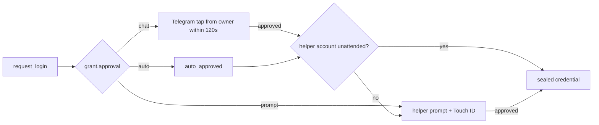

# 0007: Configurable login approval

Status: Accepted (Swift `unattended` path built, not exercised on macOS)

## Context
Every `request_login` showed a native prompt on the Mac, so the operator had to be at the machine for each sign-in. Issue #4 asked for two more modes per grant: no approval, and approval through chat. The agent must never be able to approve itself, and a compromised broker should not be able to release passwords the operator never opted in. Before this change, [ADR 0006](0006-signed-helper-protocol.md) guaranteed that even with full broker access, a password left the Keychain only after the user approved.

## Decision
- Each grant (agent x account) has `approval: prompt | chat | auto`, default `prompt`, stored in `grants.approval` (`migrations/002_grant_approval.sql`). It is set through the admin CLI only. No agent tool reads or changes it.
- `prompt`: unchanged. The helper's native prompt and Touch ID decide.
- `chat`: the broker sends a Telegram message with Approve once / Deny buttons through a bot that belongs to AgentVault, not Hermes. The broker long-polls `getUpdates` with a bot token kept in its `settings` table. A tap counts only if it comes from the configured user id in their private chat, carries the pending request id, and arrives within 120s. Each request id is removed on its first decision, so it is single use. Timeout, send failure or no configured bot returns `unavailable`. There is no fallback to the native prompt.
- `auto`: the broker approves and writes `login_approval` `auto_approved`.
- For `chat` and `auto`, the broker sends `unattended: true` to the helper. The helper skips its prompt only if the account also carries its own `unattended` flag. The operator sets that flag through the helper's UI with confirmation and Touch ID (`agentvault grant --approval chat|auto`). Without the flag, the helper prompts as before. Re-enrolling a credential clears it. On a `chat` grant this means a second, native prompt after the Telegram tap, and the two waits together can outlast the adapter's 180s timeout.
- Transaction approval always uses the native prompt, whatever the grant's mode. There is no auto-approved spending.
- The one-pending-prompt-per-session limit applies to chat prompts too.

## Why not
- Approving through Hermes' own messaging gateway: the reply would come back through the agent's own path, so the agent could approve itself.
- One-time approval links sent over Hermes: the agent can read the link and open it.
- Telegram webhooks or Discord interactions: both need a public HTTPS endpoint into the broker. Long polling is outbound only.
- Consent checked by the broker alone: a compromised broker, or anyone with Docker access as the same user, could mark any grant `auto` and silently release every password.
- Falling back from chat to the native prompt: two waits would exceed the adapter's 180s timeout, and timing out should fail closed.

## Consequences
- For accounts marked unattended, a compromised broker can release the password without a human. The same-user residual risk in the [threat model](../threat-model.md) now covers those accounts.
- Chat approval is only as strong as the operator's Telegram account and Telegram's servers. Telegram sees the agent name, site, account id and request id, but not usernames or passwords.
- The broker needs outbound HTTPS to `api.telegram.org` (via `host-link`) when chat approval is configured.
- `LoginRequest` gained `unattended`. Older helpers ignore it and prompt, which is safe. The Swift implementation compiles but has not been exercised by hand. Whether an unattended release can read a `WhenUnlockedThisDeviceOnly` item while the screen is locked is unverified.
