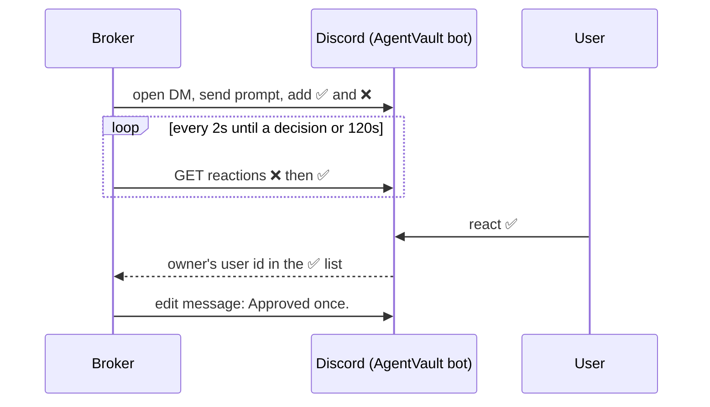

# 0008: Discord chat approval through reactions

Status: Accepted (tested against a fake Discord API, not yet against Discord)

## Context
[ADR 0007](0007-configurable-login-approval.md) made Telegram the only `chat` channel. It ruled out Discord because interactions need a public HTTPS endpoint into the broker. That holds for buttons: a click reaches a bot only through an interactions endpoint or the Gateway WebSocket. Reactions are different, because the REST API lists who reacted to a message. Issue #8 asked for Discord, so operators who run Hermes on Discord do not need Telegram as well.

## Decision
- The operator chooses one chat provider. `agentvault chat discord --user-id <id>` stores AgentVault's own Discord bot token and the operator's user id in `settings` and sets `chat_provider` to `discord`. `agentvault chat telegram` sets it back to `telegram`. Installs with no `chat_provider` keep using Telegram.
- For each `chat` login the broker opens a DM with the configured user, sends the same prompt text as Telegram, and adds ✅ and ❌ itself.
- The broker polls both reactions on that message every 2s. ✅ from the configured user id approves once, ❌ denies, and denial wins if both are present. Reactions from anyone else are ignored. Polling stops at the first decision or after 120s, and the message is edited to show the outcome.
- Each request gets its own message, so a reaction can only decide the request it was sent for. A send failure, missing configuration or timeout returns `unavailable`. There is no fallback to the native prompt or to the other provider.
- Everything else in ADR 0007 applies unchanged: the helper's `unattended` flag, the one-pending-prompt limit and native-only transaction approval.

## Why not
- Buttons over the Gateway: a nicer tap-and-acknowledge UX, but the broker would need a WebSocket lifecycle (identify, heartbeat, reconnect) and an answer within 3s. It would also need a WebSocket server dependency to test against.
- Using Hermes' own Discord bot: the agent could react to its own prompt, the same reason ADR 0007 gives for Telegram.
- Both providers at once: no operator has asked for it, and it would double the places an approval could come from.

## Consequences
- Discord sees the agent name, site, account id and request id, but not usernames or passwords. Chat approval is only as strong as the operator's Discord account.
- The bot can DM the operator only if they share a server and the operator allows DMs from that server's members. A private one-person server is enough.
- The broker needs outbound HTTPS to `discord.com` when Discord is the chat provider. A pending request costs about one REST call per second, well within Discord's rate limits.
- There is no "no longer pending" reply as Telegram gives. Reactions after the decision are ignored, and the edited message shows the outcome.
