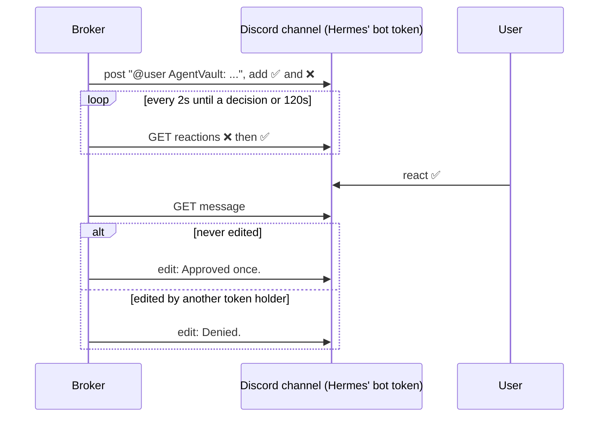

# 0009: Discord approval in a channel, through Hermes' own bot

Status: Accepted (tested against a fake Discord API, not yet against Discord). Amends [ADR 0008](0008-discord-chat-approval.md).

## Context
[ADR 0008](0008-discord-chat-approval.md) required a Discord bot that belongs to AgentVault and sent each prompt as a DM. Operators who already talk to Hermes in a Discord channel then get approvals from a second bot somewhere else. ADR 0008 ruled out Hermes' bot because "the agent could react to its own prompt". That does not hold for reactions: the bot's own reactions carry the bot's user id, and only the configured user's id counts. A bot cannot react as someone else.

What sharing the token does allow is editing or deleting the prompt. An agent that edits "Site: bank" to "Site: shop" could get an approval the operator did not mean to give.

## Decision
- `agentvault chat discord --user-id <id> --channel-id <id>` stores a channel in `settings.discord_channel_id`. The bot token may then be Hermes' own. Without `--channel-id` the broker DMs as in ADR 0008, and re-running without it clears the channel.
- In channel mode the prompt starts with a mention of the configured user, and `allowed_mentions` is limited to that user, so nobody else is pinged.
- Before counting ✅ the broker fetches the message. If `edited_timestamp` is set, the request is denied. The broker itself edits the prompt only after a decision. This check runs in DM mode too.
- Everything else in ADR 0008 is unchanged: owner-only reactions, ❌ wins, one message per request, 120s, no fallback.

## Why not
- Comparing the content instead of `edited_timestamp`: any edit sets the timestamp, so an edit and an edit back is still caught. A content check would miss that.
- Keeping DMs while reusing Hermes' bot: possible, but the operator asked for the prompt in the conversation they already have with Hermes, and the edit check covers both.

## Consequences
- With Hermes' token the agent can delete the prompt, post look-alike messages, or remove reactions if the bot has Manage Messages. None of these approve anything: a reaction counts only on the broker's own message, from the owner, and an edited prompt is denied. They can make a login time out.
- Telegram still needs AgentVault's own bot. Telegram hands each bot's updates to one long poll, so the broker and Hermes cannot share a token there.
- The bot needs View Channel, Send Messages, Add Reactions and Read Message History in that channel. Other members of the channel see the agent name, site, account id and request id.
- Chat approval is still only as strong as the operator's Discord account.
