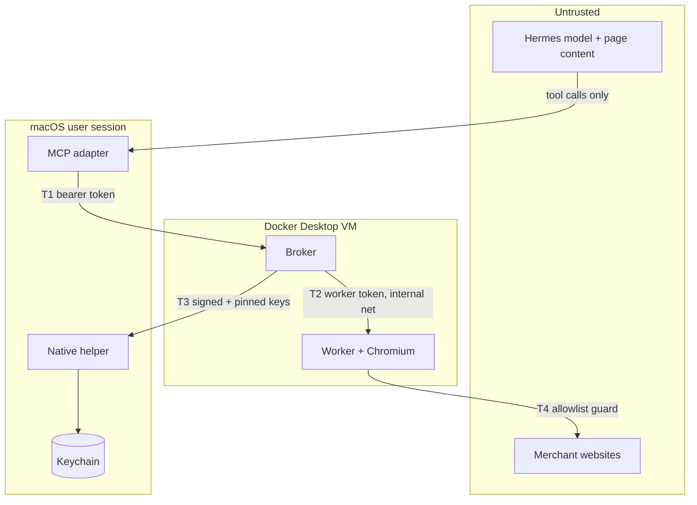
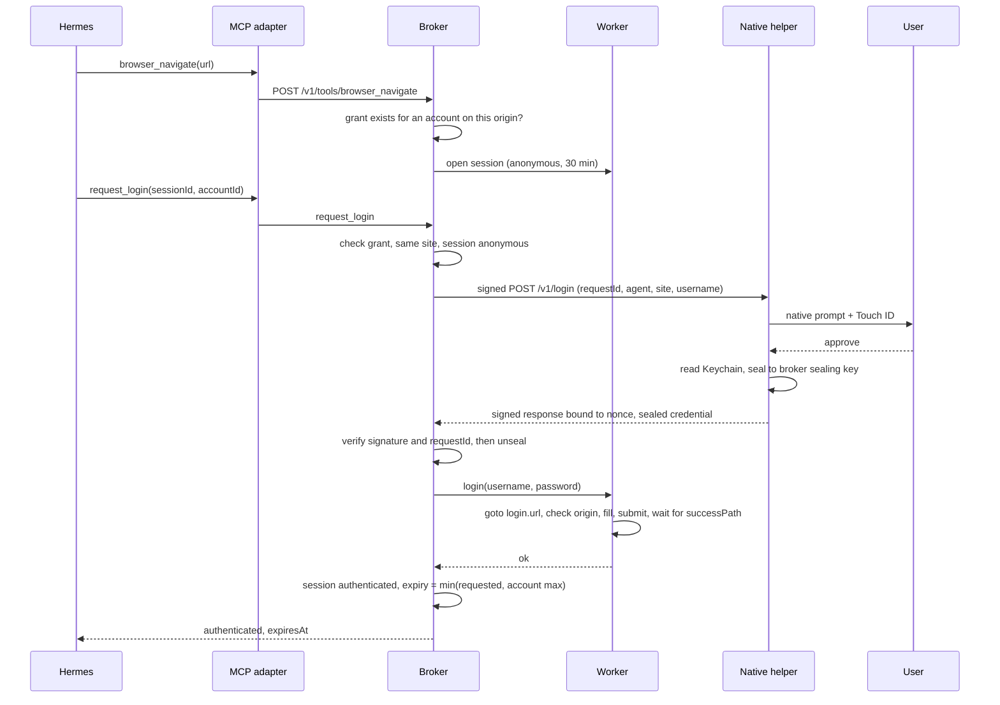
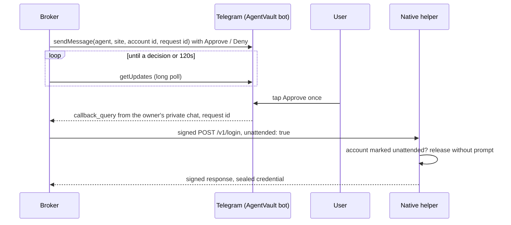
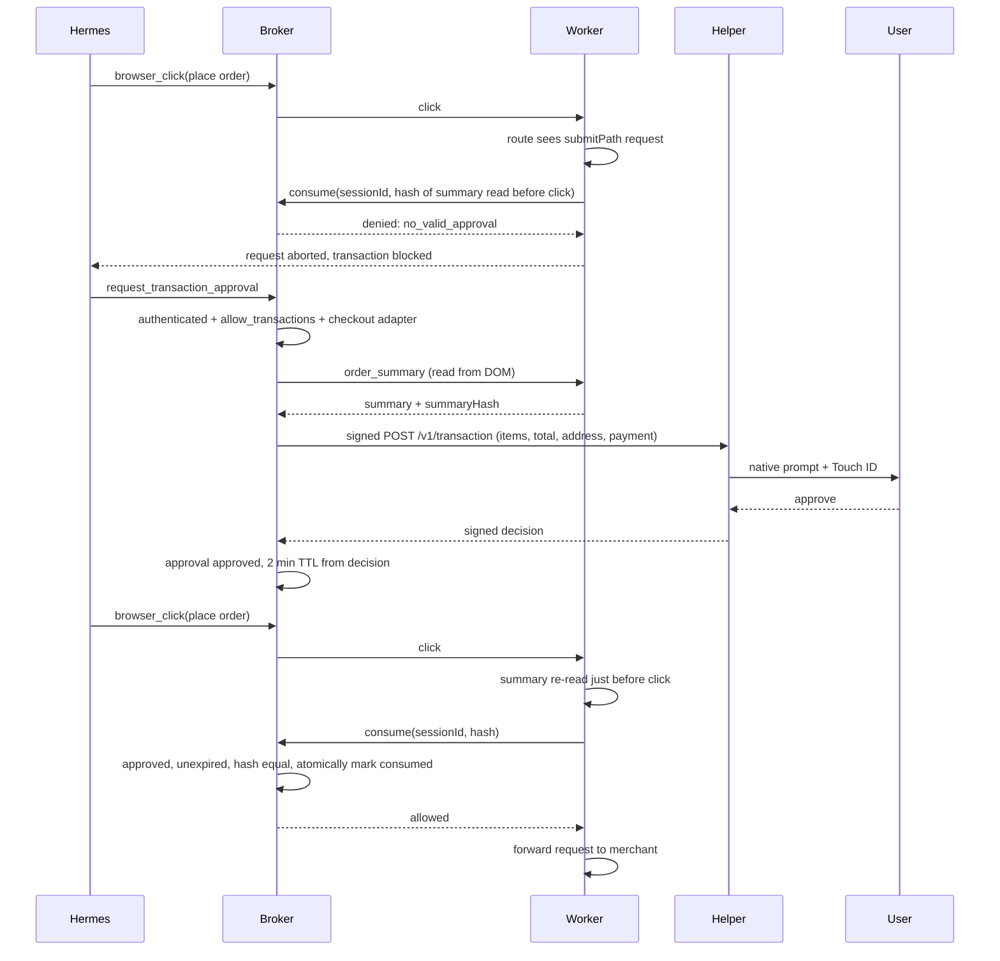
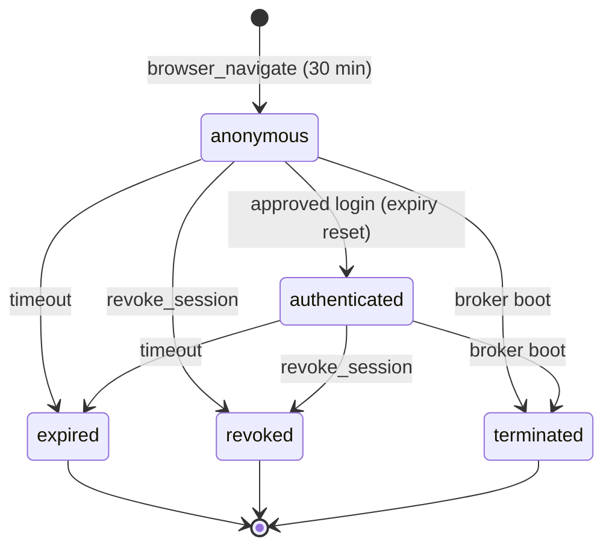

# Architecture

## Components

| Component | Runs | Responsibility | Holds |
|---|---|---|---|
| MCP adapter (`src/mcp-adapter`) | Host, spawned by Hermes over stdio | Validates tool input (zod), forwards to broker with the agent bearer token, 180s timeout for approval tools, 60s otherwise | Agent token (read from `AGENTVAULT_TOKEN_FILE`) |
| credential-broker (`src/broker`) | Docker, published `127.0.0.1:7800` | AuthN of agents, grants, session state, approvals, audit, all policy decisions. Internal API on `:7801` for the worker. Optional Telegram long poll for chat login approvals | SQLite DB, broker keypairs (volume `broker-data`), worker token (docker secret), Telegram bot token (`settings`) |
| browser-worker (`src/browser-worker`) | Docker, no published port | Playwright Chromium contexts, one per session; network guard; types the password; reads order summary; scrubs output | Session cookies and the password transiently, in memory |
| Native helper (`native/AgentVaultHelper`) | Host, LaunchAgent in the GUI session | Keychain storage, native prompts, Touch ID, signs responses, seals credentials | Passwords (Keychain), helper keypair, pinned broker keys |
| Dev helper (`src/dev-helper`) | Linux dev/CI | Same protocol as the Swift helper, plaintext store, TTY prompt | Plaintext credentials (fake only) |
| Site adapters (`sites/*.json`) | Loaded by broker, sent to worker on session open | Per-site origins, login selectors, checkout boundary | Nothing secret |

The adapter is deliberately thin. The broker is the only policy decision point; the worker enforces the network boundary it is told about but cannot mint approvals.

## Trust boundaries



| Boundary | Control |
|---|---|
| T1 agent to broker | Bearer token (stored as sha256), zod validation, per-agent grants, session ownership checks |
| T2 broker to worker | Shared token (`x-av-worker-token`, constant-time compare), `core` network is `internal: true` |
| T3 broker to helper | ECDSA-signed requests and responses, pinned keys both ways, sealed credentials, human approval |
| T4 worker to internet | Per-session origin allowlist, private-address block, redirect vetting, transaction boundary |

## Data stored

SQLite at `/data/agentvault.db` (WAL), schema in `migrations/` (applied in order by `src/broker/db.ts`).

| Table | Contents |
|---|---|
| `agents` | name, `token_hash` (sha256), disabled |
| `accounts` | id (also the Keychain account key), site id, username (plaintext), label, max session minutes |
| `grants` | agent x account, `allow_transactions`, `approval` (`prompt`, `chat` or `auto`) |
| `sessions` | id, agent, site, account, state, created/expires |
| `transaction_approvals` | session, `summary_hash`, merchant, total, currency, status, expiry |
| `audit_events` | ts, event, outcome, ids, JSON detail |
| `settings` | pinned helper public key; Telegram bot token and owner chat id when chat approval is set up |

Also in `broker-data`: `keys/identity.json` (broker signing and sealing private keys, mode 0600).

**Never stored by the broker:** passwords, session cookies, addresses, payment details, full order summaries (only merchant, total, currency and a hash), the agent token itself. The audit table is written without secrets (`test: records security events without secrets`). Passwords exist in the Keychain, in broker and worker memory during a login, and nowhere else. Worker sessions are in memory only.

## Login flow



Denied or `unavailable` (no GUI, locked, timeout) answers return `denied` or `approval_unavailable`, and the session stays anonymous. A bad signature or mismatched request id raises an error and counts as denied.

### Login approval modes

The sequence above is the default `prompt` grant. A grant can instead be `chat` or `auto` ([ADR 0007](adr/0007-configurable-login-approval.md)). The broker then decides consent itself and asks the helper with `unattended: true`. The helper skips its prompt only if the account also has its own `unattended` flag; otherwise it prompts as above.



`auto` grants skip the Telegram step and audit `login_approval` `auto_approved`. Each login writes a `login_approval` row with `channel` `chat` or `auto` for the broker's decision, then one with `channel` `helper` for the helper's answer. Taps from anyone else, for unknown request ids or after a decision are answered "no longer pending" and ignored. Transaction approval never uses these modes.

## Purchase flow



The first click shows the blocked-before-approval case. The block is at the network layer inside the worker, so it does not depend on the agent clicking the right button ([ADR 0003](adr/0003-network-level-transaction-boundary.md)). Consume denial reasons: `session_not_authenticated`, `no_valid_approval`, `approval_expired`, `order_changed_since_approval`, `approval_already_used`, `order_summary_unreadable`, `broker_unreachable`.

Sites without a `checkout` adapter return `manual_checkout_required` from `request_transaction_approval`, and the worker blocks non-GET/HEAD requests to checkout-like paths.

## Session lifecycle



Expiry is enforced three ways: on each access (`liveSession`), by a 15s sweeper in the broker, and by a timer in the worker. Revoke and boot also expire pending and approved transaction approvals. Closing a session destroys its Chromium context (cookies included). The broker calls `close-all` on the worker at startup, retrying every 3s up to 20 times.

## Broker to helper protocol

Transport: HTTP POST to `host.docker.internal:47800`, paths `/v1/login` and `/v1/transaction`. Shared definitions: `src/shared/helper-protocol.ts`, `src/shared/crypto.ts` (mirrored by `native/AgentVaultHelper/Sources/Crypto.swift`; change both together).

**Request.** Body is `LoginRequest` or `TransactionRequest` from `src/shared/helper-protocol.ts`; `LoginRequest.unattended` asks the helper to release without its prompt, which it honours only for accounts it has marked unattended. Headers `x-av-ts`, `x-av-nonce`, `x-av-signature`. Signature is ECDSA P-256 / SHA-256 (raw `r||s`, base64) by the broker signing key over:

```
POST\n<path>\n<ts>\n<nonce>\n<sha256 hex of body>
```

The helper verifies against the pinned broker key and rejects timestamps more than 30s from its clock (`MAX_CLOCK_SKEW_MS`) and reused nonces. It also refuses a login unless the account id, username and origin match what it enrolled, so the broker cannot ask for a credential to be released for a different site. This is what `src/dev-helper/helper.ts` implements; the Swift helper matches it for pairing and a fake-account login on macOS; replay rejection has not been exercised by hand.

**Response.** `{ payload, signature }` where `payload` is a JSON string and the helper signs `<nonce>\n<sha256 hex of payload>`. The broker verifies with the pinned helper key, then checks that `payload.requestId` equals the id it sent. Failures map to `helper_signature_invalid` or `helper_binding_invalid` (502), unreachable to `helper_unavailable` (503), no pinned key to `helper_unpaired` (503). None is ever treated as approval.

**Credential sealing.** On approval the helper returns `sealed: { epk, box }`:

1. Generate an ephemeral P-256 key; ECDH with the broker sealing public key.
2. HKDF-SHA256, salt = `requestId`, info = `agentvault/credential/v1`, 32 bytes.
3. AES-256-GCM with a random 12-byte nonce. `box` = nonce || ciphertext || tag (CryptoKit combined layout); `epk` = X9.63 uncompressed point.

Binding the key to `requestId` means a sealed credential cannot be replayed under another request. Plaintext is `{ username, password }`.

**Pairing** (`agentvault pair`): the CLI fetches both broker public keys (`admin pubkeys`), pipes them to `helper pair`, which stores them and prints the helper public key; the CLI pipes that to `admin pair-helper`, which stores it in `settings`. Broker private keys exist only in the `broker-data` volume, never on the macOS filesystem. Re-pairing is a deliberate admin act.

Approval timeout: 120s (`APPROVAL_TIMEOUT_MS`); the broker's HTTP timeout is 130s.

## Broker to worker

Plain HTTP on the `core` network (`internal: true`). Every call carries `x-av-worker-token`, a secret read from the docker secret `worker_token` (`./secrets/worker_token`) in both containers. The worker exposes `/sessions/{open,login,extend,action,close,close-all}`; the broker exposes only `/internal/transactions/consume` to it. Max 8 concurrent sessions. The worker is on `egress` for outbound web; the broker is on `host-link` for the helper, the published port and, when chat approval is configured, `api.telegram.org`. Containers run read-only, `cap_drop: ALL`, `no-new-privileges`, with CPU and memory limits.

## Browser session controls

- Every request, including sub-resources, goes through `context.route`; the guard checks scheme, origin allowlist (`origin` + `extraOrigins`), private-address resolution (unless `allowPrivateNetwork`), then the transaction rule.
- Redirects are fetched with `maxRedirects: 0` and each `Location` is vetted, because Playwright does not route redirect hops (found by test).
- WebSockets go through `routeWebSocket` with the same guard. Service workers, downloads, popups (single tab) and dialogs are blocked or dismissed.
- Snapshots: input values never returned, text capped at 8000 chars, password and cookie values and card-number patterns scrubbed, instruction-like text flagged (advisory), output labelled untrusted.
- Login refuses to type unless the page is on the site's own origin.
