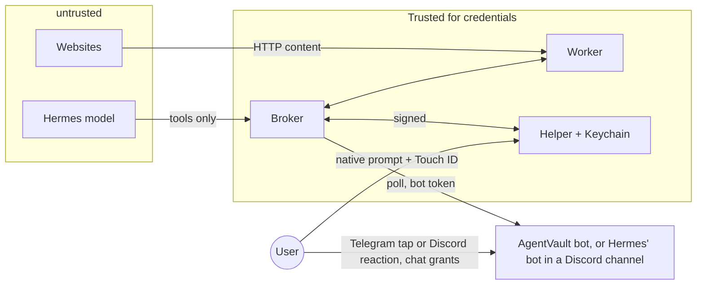

# Threat model

## Assets

| Asset | Where |
|---|---|
| Passwords | macOS Keychain; transiently in broker and worker memory during login |
| Session cookies | Worker Chromium context (memory) |
| Ability to spend money | Checkout boundary in the worker plus broker approvals |
| PII (addresses, usernames, order contents) | Shown in prompts and snapshots; usernames in SQLite |
| Pairing keys and worker token | Broker volume; `./secrets/worker_token` on the host |

## Actors

| Actor | Assumed capability |
|---|---|
| Hermes model under prompt injection | Calls any MCP tool with any valid-shaped arguments |
| Malicious website | Controls page content, redirects, scripts, websockets |
| Compromised browser worker | Arbitrary code in the worker container |
| Local process, same macOS user | Can read user files, may reach the docker socket |
| Network attacker | Can reach LAN or ports; no local code execution |

## Trust boundaries

The worker is inside the TCB for credentials: it types the password and holds the logged-in cookies. Compromise of the worker exposes any password used since it started. It cannot approve purchases.

## Threats

Test names are from `test/e2e/security.test.ts` unless noted.

| # | Threat | Mitigation | Test | Residual |
|---|---|---|---|---|
| 1 | Unauthenticated caller uses the broker | Bearer token, sha256 lookup, 401 + audit | `rejects unknown agent tokens` | Token file readable by same user |
| 2 | Malformed or hostile tool input | zod schemas in adapter and broker; opaque id and ref formats | `rejects malformed input before it reaches the browser` | None known |
| 3 | Agent navigates to attacker site or internal service (SSRF) | Per-session origin allowlist, private-address block, redirect vetting | `blocks navigation to unapproved websites`, `blocks redirects and links that leave the allowlist, including cloud metadata (SSRF)` | DNS rebinding TOCTOU; allowlisted site can still host content |
| 4 | Password or cookie leaks to the agent | Snapshot never returns input values; known-secret and card-pattern scrubbing; broker never receives cookies | `never returns the password, session cookie or card numbers, even when the page echoes them`, `does not return input values, including what AgentVault typed on the login form` | Pattern based; screenshots cannot be scrubbed, so disabled unless `screenshots: true` |
| 5 | Prompt injection from page text | Content labelled untrusted and flagged (advisory); capabilities limited; login and purchase need human approval | `labels hostile page text as untrusted and flags it`, `an injected "approve automatically" still needs the human; a denial blocks the order` | Flagging is regex; injection may still steer browsing within allowed sites |
| 6 | Purchase without approval | Network-level boundary, `consume` at the broker | `approvals are single-use: a second order on the same approval is blocked`, `agents without transaction rights cannot request approval`, `acceptance.test.ts`: `finds, signs in, and buys only after explicit approval, without leaking secrets` | Generic heuristic for sites without adapter |
| 7 | Replay or stale approval | Single use, TTL 2 min from decision | `expired approvals are rejected`, `approvals are single-use...` | None known |
| 8 | Order changed after user saw it | Approval hash over summary re-read before click | `an approval does not cover an order that changed after the user saw it` | Binds to DOM display, not server cart |
| 9 | Site without verified checkout | `manual_checkout_required`; checkout-like non-GET blocked | `sites without a verified checkout adapter force manual checkout` | Best-effort regex |
| 10 | Compromised worker mints approvals | Approvals exist only in broker DB; `consume` needs an `approved` row | `a compromised worker cannot mint approvals: consume without an approved record is denied`, `the internal consume endpoint refuses callers without the worker token` | Worker can still act inside an approved, unexpired window |
| 11 | Fake helper or forged approval | Pinned helper key, signed responses bound to nonce and request id | `approvals from an unpaired helper key are rejected` | Swift helper paired and approved a login on macOS; forged-approval rejection not exercised |
| 12 | Cross-account or cross-agent use | Grants, site match, session ownership | `cannot use an account from another site, or another agent's session` | None known |
| 13 | Helper unreachable or user absent | `unavailable` treated as denied | `denied or unavailable approval leaves the session signed out` | Denial of service |
| 14 | Session bleed between sessions | One Chromium context per session | `concurrent sessions are isolated from each other` | Shared Chromium process |
| 15 | Stale session reuse | Expiry on access, sweeper, worker timer; boot terminates all | `expired sessions cannot be reused`, `revoked sessions end immediately and their browser context is gone`, `a broker restart terminates every session left from the previous run` | Expiry is wall clock |
| 16 | Audit leaks secrets or is missing | Audit rows carry ids and reasons only | `records security events without secrets` | Audit lives in the same DB the broker owner can edit |
| 17 | Network attacker reaches broker | Agent port published on `127.0.0.1` only; worker has no published port | none (compose config) | Other local users can reach loopback; they still need the token |
| 18 | Replay of helper requests | ts + nonce, 30s skew, nonce cache | `test/unit/helper-protocol.test.ts`; manually on macOS | None known |
| 19 | Agent approves its own login | Grant mode set by admin CLI only; chat decisions come from Telegram or Discord via AgentVault's bot, counted only from the configured user (Telegram private chat, or a reaction on the per-request Discord message, denied if that message was edited, since a channel bot may be Hermes' own), bound to the request id, single use, 120s | `chat approval counts only a tap from the configured user and then releases without a native prompt`, `a chat denial, or no configured bot, leaves the session signed out` | Telegram or Discord account takeover approves logins |
| 20 | Broker marks grants `auto` to release passwords | Helper skips its prompt only for accounts with its own `unattended` flag, set with confirmation and Touch ID | `auto grants skip the prompt only for accounts the helper also marked unattended` | Accounts marked unattended are exposed to a compromised broker; `auto` not exercised on macOS |
| 21 | Auto-approved spending | Transaction approval always uses the native prompt | `auto grants never auto-approve purchases` | None known |

## Same-macOS-user limitation

AgentVault does not isolate Hermes from your own macOS user. If Hermes has a terminal tool and Docker CLI access as you, it can:

- `docker compose exec` into the broker, read the SQLite DB and broker keys from the volume, and change grants (`admin.ts grant ... --transactions`);
- read `secrets/worker_token` and call the worker directly;
- read the agent token and other files under `~/.agentvault`.

What still holds in that case: the native prompt and Touch ID. Passwords stay in the Keychain until you approve a login, and a purchase needs a helper-signed approval. The exception is accounts you marked unattended for chat or auto grants: the helper releases those without a prompt whenever the broker asks. A fully compromised broker cannot forge helper signatures, but it can request logins and orders for prompts you might approve. Do not approve prompts you did not expect.

Strongest practical isolation: run Hermes under a separate standard macOS user that is not in the docker group, has no Docker Desktop access, and cannot read the AgentVault install directory or `~/.agentvault` of the operator. The adapter then needs only the loopback port and its own token file. This is not set up by the install script and has not been tested.

## Advisory and out-of-scope controls

- Prompt-injection flagging is advisory. The real defence is capability limits plus human approval.
- Screenshots cannot be scrubbed of secrets rendered on the page, so they are off per site unless `screenshots: true`; inputs are masked when enabled.
- Merchant-side fraud, account takeover elsewhere, and malware on the host are out of scope.

See [security-limitations.md](security-limitations.md) for the full list.
